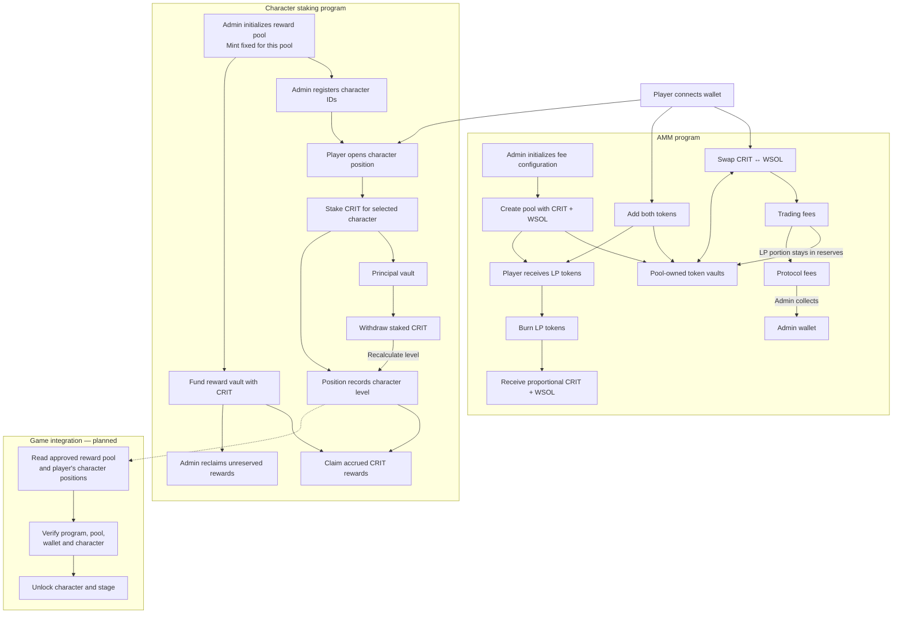
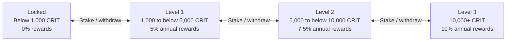

# Critbit Anchor programs

Two Anchor 1.1.2 programs implement a constant-product AMM and token staking that
unlocks Critbit characters. Both accept the classic SPL Token program only.
Wrapped SOL can be used as an AMM token; wrapping/unwrapping belongs in the client.

## Build and test

From this directory, using Anchor CLI 1.1.2, Rust, and Solana build tools:

```sh
cargo test --workspace
anchor build
cargo test -p critbit-program-tests --test runtime -- --ignored
```

Program IDs in `declare_id!`, `Anchor.toml` (localnet and devnet), generated IDLs,
and deployment keys must match. Run `anchor keys list` to inspect public deployment
addresses. Build without `--ignore-keys` to catch mismatches. Rebuild after changing
program IDs before deploying; changing source or IDLs alone does not update an
already deployed binary. Build output and generated deployment keys are excluded
from Git.

The runtime tests load both compiled `.so` files into LiteSVM, create disposable
accounts in memory, and run real instructions and token CPIs without an RPC or
wallet file. They require a fresh build and are explicitly ignored in the default
host-only test run. IDLs and TypeScript types are generated in `target/idl` and
`target/types` by `anchor build`.

## AMM

- `initialize_config(fee_bps, protocol_share_bps)`: one immutable configuration
  per admin. Fees are basis points of input; protocol share is basis points of
  that fee. Example: 30 and 2,000 means a 0.3% trading fee, of which 20% goes to
  the protocol and 80% remains with LPs.
- `create_pool(amount_a, amount_b, min_shares, deadline)`: config admin authorizes
  creation; creator funds both reserves atomically. Mints must be ordered by
  public key. The initial price follows the deposited ratio, adjusted by decimals.
- `add_liquidity(shares, max_a, max_b, deadline)`: request an exact LP amount;
  required deposits round upward. The user supplies an existing LP token account.
- `remove_liquidity(shares, min_a, min_b, deadline)`: burn LP tokens and withdraw
  proportional reserves, rounded downward.
- `swap(a_to_b, input, min_output, deadline)`: exact-input swaps in either direction.
- `collect_protocol_fees()`: config admin collects only accounted protocol fees.

Initial LP supply is `floor(sqrt(amount_a * amount_b))` in base units. 1,000 LP
base units stay permanently locked in a pool-owned token account. Reserve balances
exclude outstanding protocol fees. Direct reserve donations benefit LPs and affect
price; this program does not expose a price oracle. A small initial pool is still
susceptible to price manipulation; minimum locked shares do not eliminate that.

Pool PDA: `["pool", config, mint_a, mint_b]`. Pool-owned vaults and the LP mint
are derived from its address. The creator's initial LP token account is a PDA
owned by the creator; future LP accounts may be ordinary token accounts or ATAs.
All amounts are raw token base units and deadlines are Unix seconds.

## Critbit staking

See [staking rules](programs/staking/README.md) for account layout and assumptions.

| Level | Total tokens allocated to one character | Annual simple reward rate |
| --- | ---: | ---: |
| Locked | Below 1,000 | 0% |
| 1 | 1,000 | 5% |
| 2 | 5,000 | 7.5% |
| 3 | 10,000+ | 10% |

Stake and rewards use the same mint but separate vaults. Tokens assigned to one
character cannot unlock another. Withdrawals are immediate and downgrade/relock
the character; already earned rewards remain claimable. Unlocks are not permanent.

Annual simple rates on the entire allocated balance, open character eligibility,
and immediate withdrawals are implementation defaults pending product confirmation.
A fixed campaign end and pre-reserved rewards make every accepted stake fundable.
There is no automatic compounding, AMM fee routing, NFT gating, or game integration.

## Accounts created and how they are built

Both programs use Anchor's `#[derive(Accounts)]` instruction structs to declare
which accounts are created and validated. An `#[account(init, payer = ..., ...)]`
constraint creates the account during that instruction, with the payer supplying
rent-exempt lamports. Program state uses `space = 8 + Type::INIT_SPACE`: an
8-byte Anchor discriminator followed by the serialized fields of the Rust state
struct. The fixed layouts live in each program's `src/state/` directory.

Every account listed below has a program-derived address (PDA). Derive it from
the listed seeds and the **respective AMM or staking program ID** using
`findProgramAddressSync` in a client (or `Pubkey::find_program_address` in Rust).
Quoted seeds are literal UTF-8 bytes; account names in seeds mean their public-key
bytes. Anchor finds and validates the bump; the state accounts store their bump.
A PDA has no private key: the deriving program can sign token CPIs with its seeds
and bump.

State accounts are owned by their AMM or staking program. Token accounts and
mints are owned by the classic SPL Token program, even when their addresses are
PDAs derived by the AMM or staking program. A token account's **authority** is the
wallet or pool PDA permitted to move its tokens; this is distinct from its Solana
program owner. Anchor's `token::mint`, `token::authority`, and `mint::authority`
constraints initialize these SPL accounts with the specified mint and authority.
These vaults are custom PDAs, not associated token accounts (ATAs).

### AMM accounts

`initialize_config` creates one account, paid for by `admin`.
`create_pool` creates the other six, paid for by `creator`, with the config admin
also signing to authorize pool creation.

| Account | PDA seeds | Purpose and contents |
| --- | --- | --- |
| `config` (`Config`) | `["config", admin]` | Stores the admin, trading fee in basis points, protocol share of that fee, and bump. One immutable config per admin. |
| `pool` (`Pool`) | `["pool", config, mint_a, mint_b]` | Stores the config, both mint addresses, both vault addresses, LP mint address, protocol fee counters for A/B, and bump. Acts as token authority for the reserves and locked LP tokens, and mint authority for LP shares. Mints must satisfy `mint_a < mint_b` by public key. |
| `vault_a` (SPL token account) | `["vault_a", pool]` | Holds token A; mint is `mint_a`, authority is `pool`. |
| `vault_b` (SPL token account) | `["vault_b", pool]` | Holds token B; mint is `mint_b`, authority is `pool`. Both vaults hold liquidity plus uncollected protocol fees; the counters in `Pool` distinguish the fees from usable reserves. |
| `lp_mint` (SPL mint) | `["lp_mint", pool]` | Creates fungible liquidity shares with 9 decimals and `pool` as mint authority. |
| `locked_lp` (SPL token account) | `["locked_lp", pool]` | Holds the permanently locked 1,000 LP base units; mint is `lp_mint`, authority is `pool`. |
| `creator_lp` (SPL token account) | `["initial_lp", pool, creator]` | Receives the creator's initial LP shares; mint is `lp_mint`, authority is the creator wallet. Its PDA address does not give the pool control of the creator's shares. |

Pool creation initializes both protocol fee counters to zero, transfers the
creator's A/B deposits into the vaults, and mints the initial LP supply between
`creator_lp` and `locked_lp` atomically. Later adds, removals, swaps, and fee
collections reuse these accounts; they do not create new accounts.

The underlying `mint_a`/`mint_b`, creator deposit accounts, and user/admin token
accounts must already exist. Clients create any additional LP token accounts or
ATAs before supplying them to the program. There is no separate AMM state account
per liquidity provider: their LP token balance represents their share.

Source: [creation constraints](programs/amm/src/instructions/create_pool.rs),
[config initialization](programs/amm/src/instructions/initialize_config.rs), and
[state layouts](programs/amm/src/state/).

### Staking accounts

| Account | Created by / rent payer | PDA seeds | Purpose and contents |
| --- | --- | --- | --- |
| `pool` (`RewardPool`) | `initialize_pool` / admin | `["reward_pool", admin, mint]` | Stores admin, staking mint, both vault addresses, campaign end timestamp, total stake, aggregate reserved rewards, and bump. Acts as token authority for both vaults. One pool per admin/mint pair. |
| `stake_vault` (SPL token account) | `initialize_pool` / admin | `["stake_vault", pool]` | Holds all users' deposited principal for this pool, using `mint` and `pool` as authority. Individual allocations are tracked in positions. |
| `reward_vault` (SPL token account) | `initialize_pool` / admin | `["reward_vault", pool]` | Holds separately funded rewards in the same mint, with `pool` as authority. Reserved rewards stay available for claims; admin can reclaim only surplus. |
| `character` (`CharacterConfig`) | `register_character` / admin | `["character", pool, character_id.to_le_bytes()]` | Stores pool, `u32` character ID, three immutable tiers, and bump. Each tier stores level, required stake in base units, and annual reward rate in basis points. The ID seed is exactly four little-endian bytes. |
| `position` (`CharacterPosition`) | `open_position` / owner | `["position", pool, owner, character]` | Stores pool, wallet owner, character config address, staked amount, level, rate, pending rewards, last reward timestamp, fractional reward remainder, reserved rewards, and bump. One position per wallet/character/pool. |

`initialize_pool` creates empty vaults and zeroes the pool's stake and reservation
counters; the end timestamp is initialization time plus `duration_seconds`.
`register_character` converts the fixed 1,000 / 5,000 / 10,000 token thresholds
into base units using the existing mint's decimals. `open_position` initializes
an empty, level-0 position with its reward timestamp set to the current time.
Opening a position does not create a token account or transfer stake.

Funding, staking, unstaking, claiming, and reclaiming reuse these accounts and
existing wallet token accounts. The staking mint must already exist; this program
does not mint a new staking token, NFT, or token per character. `close_position`
closes an empty position and returns its rent lamports to the owner once stake
and payable whole-unit rewards are zero, forfeiting any fractional reward dust.

Source: [pool initialization](programs/staking/src/instructions/initialize_pool.rs),
[character registration](programs/staking/src/instructions/register_character.rs),
[position creation](programs/staking/src/instructions/open_position.rs), and
[state layouts](programs/staking/src/state/).

## Program flows

The AMM and staking programs operate independently. The game connection shown
below is planned and has not been implemented yet. CRIT refers to the token mint
selected for the pool, rather than a hardcoded token address.



### Character level transitions

Levels follow the total stake allocated to each character. Transitions can skip
levels when a single deposit or withdrawal crosses multiple thresholds.



Rewards settle at the previous level before a stake change. AMM fees do not
currently fund staking rewards automatically; the reward vault must be funded
separately.

## Test locations

- `crates/program-tests/tests/accounting.rs`: fee/invariant checks, liquidity
  rounding, tier boundaries, fractional accrual, upgrades, and reward obligations.
- `crates/program-tests/tests/runtime.rs`: compiled program lifecycle tests,
  authorization/account substitutions, slippage, claims, and reclaim limits.
- `tests/integration/custom.rs`: intentionally empty custom integration boilerplate.
- `tests/custom-testing`: existing user-provided client sandbox, not part of this
  build/test suite and not updated to the new IDLs.

These programs are a tested initial implementation, not an independent security
audit. No programs have been deployed and no real funds have been used.
